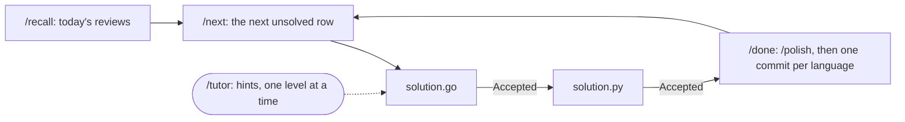

# leetcode

LeetCode solutions in Go and Python, worked through
[NeetCode 250](lists/neetcode-250.md) pattern by pattern rather than by
problem number. Each problem keeps one final solution per language, each
written in its own language's idiom, never translated from the other.

> [!IMPORTANT]
> There are no tests. Every solution pastes into LeetCode as is, apart from
> Go's `package` line; the judge's Accepted is what makes a solution correct.

## The path

NeetCode 250's problems in the order of its roadmap, where each pattern
builds on the ones before it. Progress is tracked per problem and language
in [lists/neetcode-250.md](lists/neetcode-250.md).

| #   | Pattern                                                                  | Easy | Medium | Hard | Total |
| --- | ------------------------------------------------------------------------ | ---: | -----: | ---: | ----: |
| 1   | [Arrays & Hashing](lists/neetcode-250.md#arrays--hashing)                |    9 |     12 |    1 |    22 |
| 2   | [Two Pointers](lists/neetcode-250.md#two-pointers)                       |    6 |      6 |    1 |    13 |
| 3   | [Sliding Window](lists/neetcode-250.md#sliding-window)                   |    2 |      5 |    2 |     9 |
| 4   | [Stack](lists/neetcode-250.md#stack)                                     |    4 |      8 |    2 |    14 |
| 5   | [Binary Search](lists/neetcode-250.md#binary-search)                     |    4 |      7 |    3 |    14 |
| 6   | [Linked List](lists/neetcode-250.md#linked-list)                         |    3 |      8 |    3 |    14 |
| 7   | [Trees](lists/neetcode-250.md#trees)                                     |    9 |     12 |    2 |    23 |
| 8   | [Tries](lists/neetcode-250.md#tries)                                     |    0 |      3 |    1 |     4 |
| 9   | [Heap / Priority Queue](lists/neetcode-250.md#heap--priority-queue)      |    2 |      8 |    2 |    12 |
| 10  | [Backtracking](lists/neetcode-250.md#backtracking)                       |    1 |     13 |    3 |    17 |
| 11  | [Graphs](lists/neetcode-250.md#graphs)                                   |    3 |     17 |    1 |    21 |
| 12  | [Advanced Graphs](lists/neetcode-250.md#advanced-graphs)                 |    0 |      4 |    6 |    10 |
| 13  | [1-D Dynamic Programming](lists/neetcode-250.md#1-d-dynamic-programming) |    3 |     13 |    1 |    17 |
| 14  | [2-D Dynamic Programming](lists/neetcode-250.md#2-d-dynamic-programming) |    0 |     12 |    4 |    16 |
| 15  | [Greedy](lists/neetcode-250.md#greedy)                                   |    1 |     12 |    1 |    14 |
| 16  | [Intervals](lists/neetcode-250.md#intervals)                             |    1 |      4 |    2 |     7 |
| 17  | [Math & Geometry](lists/neetcode-250.md#math--geometry)                  |    6 |      7 |    0 |    13 |
| 18  | [Bit Manipulation](lists/neetcode-250.md#bit-manipulation)               |    6 |      4 |    0 |    10 |
|     | **Total**                                                                |   60 |    155 |   35 |   250 |

Seven of the 250 are LeetCode Premium problems, marked 🔒 in the list and
skipped for now. What comes after the 250 is decided when they are done.

## How a problem is worked



The slash commands are Claude Code skills:

- **`/recall`** serves the accepted problems due today, one at a time, as a
  blank stub to solve again, and grades the attempt against the committed
  solution. A problem comes back 3, 7 and 21 days after it was last written,
  counted from the day it actually was, at most five a day.
- **`/next`** scaffolds the next unsolved problem of the list from
  LeetCode's own stubs, and skips Premium problems.
- **`/tutor <number>`** restates the problem and then gives graduated hints,
  from a nudging question to a full explained solution, one level per
  request. It writes no code before the last level and never touches the
  files.
- **`/polish <number>`** rewrites an accepted solution to the standard of the
  language's own library, the newest idiom the judge allows, and explains
  each change with its source. Whatever it changes is submitted again.
- **`/done <number>`** runs `/polish`, asks before keeping anything it
  changed, and commits each language on its own, filling its cell in the
  list.

## What a problem looks like

```text
problems/0206-reverse-linked-list/
├── solution.go   # pasted without its package line
├── solution.py   # pasted whole
└── judge.go      # LeetCode's ListNode, never pasted
```

The directory is the problem's number and its slug from the LeetCode URL.
`judge.go` exists only where the judge provides a type or a function; in
Python a provided class opens `solution.py` instead, and a provided API is
declared in [`__builtins__.pyi`](__builtins__.pyi).

## Toolchain

The judge's language versions are the ceiling. Each toolchain is pinned to
them, so newer syntax or a newer library call fails locally instead of at the
judge.

| Language             | Judge       | Formatted by       | Checked by                                 |
| -------------------- | ----------- | ------------------ | ------------------------------------------ |
| Go                   | Go 1.27     | gofumpt, goimports | golangci-lint (with `modernize`), `go vet` |
| Python               | Python 3.14 | ruff               | ruff, pyright in strict mode               |
| Markdown, YAML, JSON | n/a         | Prettier           | Prettier, markdownlint for Markdown        |
| Shell                | n/a         | shfmt              | ShellCheck                                 |

Every checker's version is pinned too, in the [Makefile](Makefile),
[pyproject.toml](pyproject.toml) with `uv.lock`, and
[package.json](package.json) with `pnpm-lock.yaml`.

## Getting started

With [Go](https://go.dev/), [uv](https://docs.astral.sh/uv/),
[Node.js](https://nodejs.org/), [pnpm](https://pnpm.io/),
[jq](https://jqlang.org/) and [Claude Code](https://code.claude.com/) installed:

```sh
make setup   # once per clone: pinned tools and git hooks
make fmt     # format everything in place
make check   # lint everything; the pre-commit hook checks what a commit stages
```

`make help` lists the rest.

## Conventions

[AGENTS.md](AGENTS.md) holds them all, for people and agents alike: what a
solution may and may not contain, where LeetCode's platform overrides the
style guides, the order of those style guides, and how commits are written:

```text
feat(go): add 0206 reverse linked list
feat(python): add 0206 reverse linked list
```

## License

[Apache 2.0](LICENSE). The problems themselves belong to LeetCode; this
repository holds only solutions to them.
